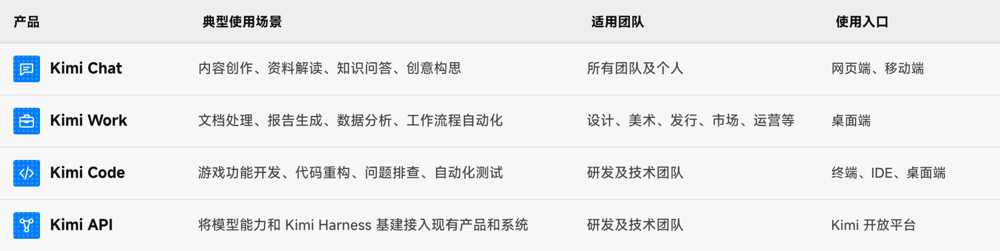

AI 产品小易

产品拆解 · 2026.11

模板预览

# 一篇文章的样子：标题、导语和正文

这是导语。用一两句话交代这篇文章讲什么、为什么值得读，读者扫一眼就知道要不要往下看。

假设你在挑一套公众号排版。正文要读着舒服，标题要一眼看清层级，图注和引用不能抢正文的戏。这一页把常见的元素都放了一遍，方便对比。

本篇内容

<b>01</b>　正文和强调

<b>02</b>　图片、表格和引用

## 01 正文和强调 | TEXT

正文段落是读者停留最久的地方。这里有一处**加粗的重点**，还有一个[链接到官网的说明](https://example.com)，以及一点*斜体*。

- 列表第一项：说清楚一件事
- 列表第二项：再补一个细节

### 三级小标题

> 好的排版让人忘记排版，只记得内容。

## 02 图片、表格和引用 | MEDIA

<b>图 1</b>图注写在图片下面，说明图片是什么、来源是哪。

<!-- fig: 三种方案对比 -->
| 方案 | 适合谁 | 价格 |
|---|---|---|
| A | 个人创作者 | 免费 |
| B | 小团队 | 每月 99 元 |

<b>表 1</b>表格也可以带图注。

<b>一手资料</b>　<a href="https://example.com">官方发布页</a>（2026-11-03）。

<b>AI 产品小易</b> 深度了解每一个 AI 产品

